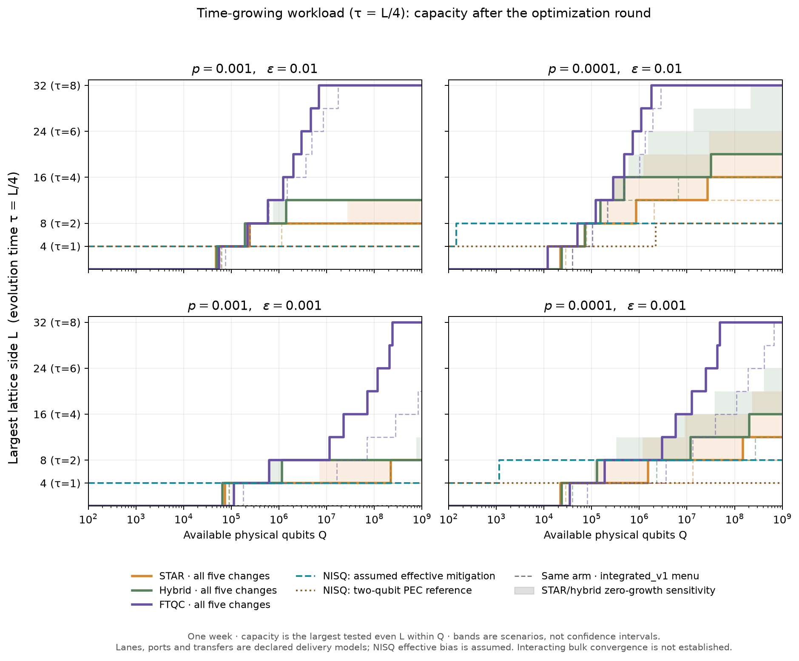
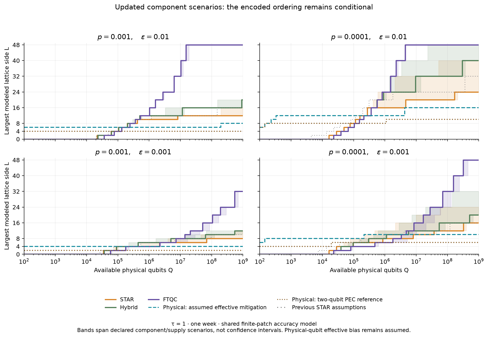
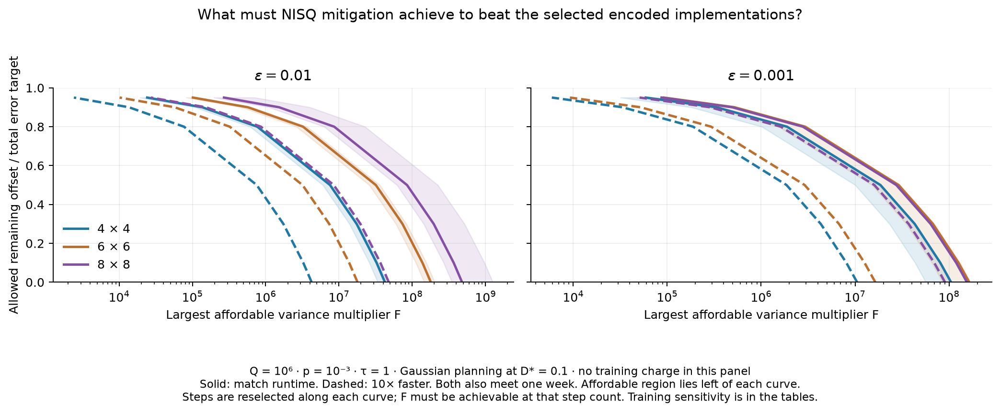
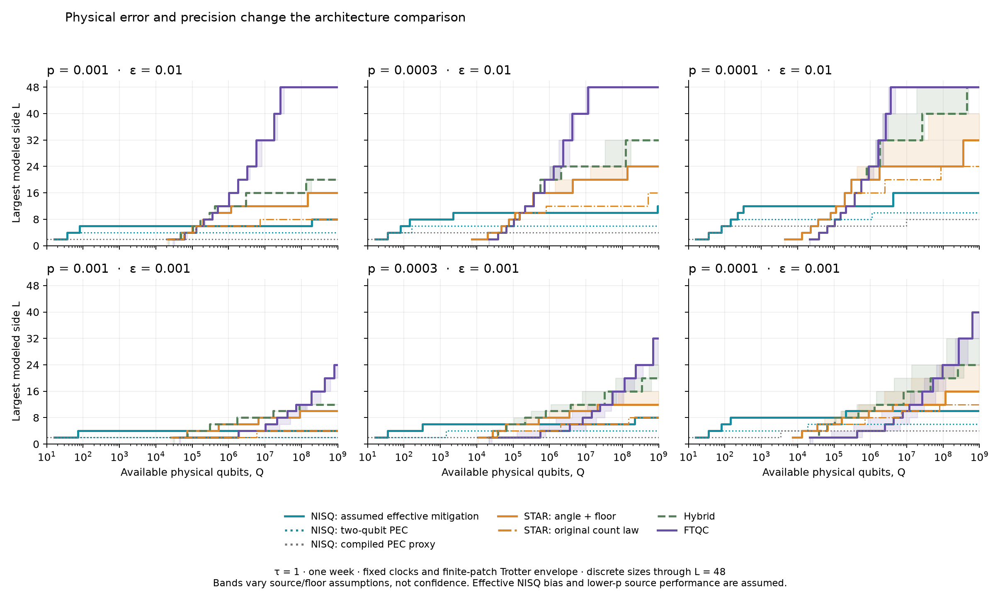

# Hubbard dynamics on a fixed qubit array

**Latest: [optimization round](results/optimization_round_v1/summary.md)**
([findings and methods](docs/OPTIMIZATION_ROUND.md)). It implements the five changes agreed in
[OPUS55_REVIEW.md](OPUS55_REVIEW.md) §0 and reports which choices change the capacity leader.
It leads with the time-growing workload (τ = L/4). Companion notes cover the
[raw-RUS versus PCEC question](docs/RAW_RUS_NOTE.md) and the
[Stim calibration of the surface-code law](docs/SURFACE_LAW.md) (Λ = 7.4 rather than 10 at p = 10⁻³; not yet propagated).



Start with the **[integrated comparison and NISQ requirements](results/integrated_v1/summary.md)**.
This updates the encoded capacity comparison with the existing angle-dependent
STAR channels, acceptance and growth scenarios, and FT's tested synthesis menu.
The NISQ figure asks what sampling overhead and remaining systematic offset
would be needed to match or beat the selected encoded implementations.
It does not assume that an experimental mitigation method attains those values.





The bands span declared component and supply scenarios, not confidence intervals.
No unconditional NISQ size boundary or complete physical injection/surgery
validation is claimed. See the [methods](docs/INTEGRATED_COMPARISON.md),
[main manuscript](tex/main.pdf), and [reproduction commands](docs/REPRODUCING.md).
`make integrated` resumes the new calculation; `make integrated-figures` redraws
saved results. Earlier result versions below remain available for comparison.

The **[published-benchmark checks](results/published_benchmarks_v1/summary.md)**
reconstruct TopQAD's STAR/FT resource ledger on its original energy-estimation
task and reduce the Phasecraft/Quantinuum experimental shots and processed
observables. The STAR footprints and most runtimes agree with the publication;
two inconsistent table entries remain flagged. The experiment demonstrates
low-shot observable estimates using spatial averaging, training and smoothing,
with a different accuracy contract from our local-observable comparison.
These are accounting and data checks, not a validation of complete injection
gadgets or an experimental mitigation model. See the
[methods and confidence table](docs/PUBLISHED_BENCHMARKS.md);
`make published-benchmarks` reproduces the report and figures offline.

The **[Willow data follow-up](results/willow_v1/summary.md)** reduces 36
superconducting workloads spanning 4×4 and 6×6, both fluxes, three interactions
and one to three Trotter steps. It reconstructs the archive's selection and
symmetry processing, separates free-circuit and continuous references, and
compares observed accuracy and sampling costs. The interacting exact reference
groups are empty in this archive, so the interacting comparisons retain their
finite-bond MPS scope. See the [methods](docs/WILLOW_BENCHMARK.md).
`make willow-benchmark` regenerates these results offline.

The **[matched interacting reference](results/willow_reference_v1/summary.md)**
adds independent continuous evolution and ideal experimental circuits for
4×4, U=4 and zero flux, at all 24 saved times and all three step counts.
It separates observed experimental discrepancy from Trotter error and checks
the approximate classical references. The reconstructed swap-network order
reproduces all 288 available free-circuit reference points after the published
diagonal symmetry averaging. See the [methods](docs/WILLOW_REFERENCE.md);
`make willow-reference` regenerates the comparison offline.

The **[same-task algorithm and component study](results/frontier_v1/summary.md)**
adds open-boundary qubitization, 24 million decoded growth shots toward distances
13 and 25, explicit magic-state transport, measured exposure diagnostics, and a
centered locality certificate. The tested QSVT implementation does not beat the
best tested Trotter scenario; the larger growth data constrain a component rather
than validating full STAR injection. See the [methods and replay](docs/FRONTIER_WORK.md)
and the updated [main manuscript](tex/main.pdf).

The **[implementation checks](results/implementation_v1/summary.md)** measure
held-out NISQ mitigation bias, STAR channel and small-patch growth behavior,
CUDA-Q Hamming-weight arithmetic with nearest-neighbor data routing, and finite-patch
truncation. See the [methods](docs/IMPLEMENTATION_CHECKS.md). These constrain the
assumptions behind the capacity comparison without silently replacing it.

The earlier **[physical-error and algorithm comparison](results/physics_sweep_v1/summary.md)**
retains the scalar injection law as a controlled reference. The analytical
[assumptions and formulas](docs/DISCUSSION_MODEL.md) remain the common model.



That historical sweep varies p = 0.001, 0.0003, and 0.0001 at 0.01 and 0.001 absolute
error. All 144 matching p = 0.001 cases reproduce the frozen baseline.
Source quality and STAR floors at lower p are explicit scenarios, not new
gadget calibrations. Both precision targets remain prominent.

The [algorithm comparison](figures/hamming_weight_comparison.pdf) finds that
Hamming-weight phasing lowers the strict 4 × 4 FT estimate from 1.88 million
to 278,192 qubits, including workspace and arithmetic under its aggregate delivery model. The new
[explicit stage](figures/implementation_ft.pdf) confirms the T-count saving but
shows that routing can erase the runtime benefit with a faster source. At loose precision,
individual synthesis remains cheaper for 4 × 4 and 8 × 8. Compact-encoding
counts and an independent small-patch ordering diagnostic are retained in the
[same results directory](results/physics_sweep_v1/summary.md).

The **[workshop reconciliation](results/workshop_reconciliation_v1/summary.md)**
evaluates all three codebases at 4 × 4, tau = 1,2, common steps, 0.01 absolute
error, and a 240 ns syndrome cycle. Compilation, estimator, and delivery
differences remain explicit; similar headline capacities do not establish an
independent validation. A small source archive makes the comparison reproducible
without modifying the supplied repositories.

The **[direct-check summary](results/dynamics_followup_v1/summary.md)** and
[patch-capacity figure](figures/patch_capacity.pdf) retain the finite-size study.

The current comparison includes exact 4 × 4 calibration at tau = 1,2,4.
It shows the effect of adding larger patches while holding reference delivery and source
menus fixed. Both curves optimize the error allocation and step count. All
16 saved tau = 1 headline allocations now pass their directly measured
Trotter allowances. See the [method and scope](docs/DIRECT_CHECKS_AND_TIME_EXTENSION.md).
Larger-lattice transfer and effective NISQ residual bias remain assumptions.

The earlier **[discussion-v3 reference](results/discussion_v3/summary.md)**
retains the 3 × 3 planning envelope and the longer time grid:

Its curves optimize each arm's error allocation, step count, and resource-state
supply. Small-patch Trotter coefficients are measured through tau = 8 for both termwise
and plaquette orderings; the planning envelope avoids isolated small-patch
cancellations. See the [calibration figure](figures/time_calibration.pdf).
Larger-lattice transfer and effective NISQ residual bias remain assumptions.
The [0.01 absolute-precision sensitivity](figures/discussion_capacity_loose.pdf)
is also available. The fourth panel follows tau = L/4, stopping at L = 32 to
stay within the measured time interval. Run `make discussion` to regenerate
these estimates from saved calibration.

The new [encoded-delivery comparison](figures/delivery_capacity.pdf) tests
whole-block consumption rates, analog lanes, and shared source supply.
[Details and the large-patch method](docs/DELIVERY_AND_LARGE_PATCH.md) separate
published block rates from uncompiled parallelism assumptions. The
[completed 4 × 4 calculation](results/dynamics_4x4/summary.md) now checks
finite-lattice transfer at tau = 1; [this figure](figures/large_patch_calibration.pdf)
shows the ordering-dependent difference from the smaller patches. The
[time extension](figures/patch_time_extension.pdf) adds the tau = 2,4 checks.

Start with the **[main manuscript](tex/main.pdf)** ([LaTeX](tex/main.tex),
[bibliography](tex/references.bib)). It brings together the analytical resource
laws, CUDA-Q compilation, mitigation, STAR, FTQC and hybrid supply, and the
small-system accuracy checks.

The principal comparison is **maximum modeled lattice size versus available
physical qubits**, subject to a one-week runtime cutoff.

The separate [compiled-reference capacity plot](figures/capacity_vs_qubits.pdf)
retains the more detailed previous implementations.

These are conditional four-step circuit costs. Four steps fail the accuracy
target on the small square patches checked; the current 4 × 4 calibration uses different step counts.
The staircases show only tested sizes, and reaching 8 × 8 marks the end of the
current sweep. The [underlying CSV](results/presentation_v1/capacity_thresholds.csv)
retains the original area thresholds.

The NISQ curve is a **sufficient gatewise-PEC sampling budget**, not an
optimized NISQ limit. Its 4 × 4 circuit uses 32 active qubits (36 including
square packing); the strict-precision estimate buys 59,239 replicas to
complete the prescribed shot budget within a week. See the
[experimental comparison and cost breakdown](docs/NISQ_EXPERIMENT_COMPARISON.md)
for why this does not predict the resources used in the Phasecraft experiments.

The [architecture overview](figures/architecture_overview.pdf) and
[patch/supply detail](figures/architecture_detail.pdf) explain resource roles.
The [rotation protocols](figures/rotation_protocols.pdf) show the distinction
in time: STAR injects angle-specific states with retries, while FTQC consumes
high-fidelity T states in a synthesized sequence. Both encoded approaches
share protected Clifford operations; STAR preparation can reuse surgery
ancillas. These drawings are schematic and available as editable SVG,
vector PDF, and PNG in `figures/`.

| Location | Purpose |
|---|---|
| `python/` | Models, compilers, plotting, build and audit scripts |
| `cpp/` | Matrix-free fixed-spin-sector dynamics kernel |
| `pbs/` | Bounded Improv smoke and calibration jobs |
| `tests/` | Independent mathematical and implementation checks |
| `configs/` | Assumptions, compiler dependency lock, historical filename map |
| `tex/main.tex` | One complete current manuscript |
| `tex/references.bib` | Dedicated bibliography for the main manuscript |
| `tex/archive/` | Earlier complete notes and their original PDFs/bibliographies |
| `figures/` | Current capacity plots, algorithm comparisons, and architecture cartoons |
| `results/` | Versioned numerical evidence, compiler artifacts, and manifests |
| `docs/` | Accepted decisions, reproduction guide, older plans and reviews |
| `refs/` | Reference papers |

Use the existing science environment, then:

```bash
conda activate qb_gsee
make test
make paper
make audit
```

`make paper` regenerates the current figures and builds `tex/main.pdf`.
It does not rerun the scientific calculations. To specify an interpreter,
use `make PYTHON=/path/to/python paper`. The build helper uses Tectonic on
PATH or the existing local package cache; `latexmk -pdf main.tex` from `tex/`
also works with a standard TeX installation.

See [REPRODUCING.md](docs/REPRODUCING.md) for scientific reruns, the isolated
CPU CUDA-Q environment, archived-note builds, and compressed MLIR handling.
[WORKING_DECISIONS.md](docs/WORKING_DECISIONS.md) records the accepted conventions.
`PLAN.md` remains at the root because it had an active editor lock during the
reorganization. The latest chronological calculation report is
[REFINEMENT_V3.md](docs/archive/REFINEMENT_V3.md); its source datasets and original
hash manifest remain intact.
