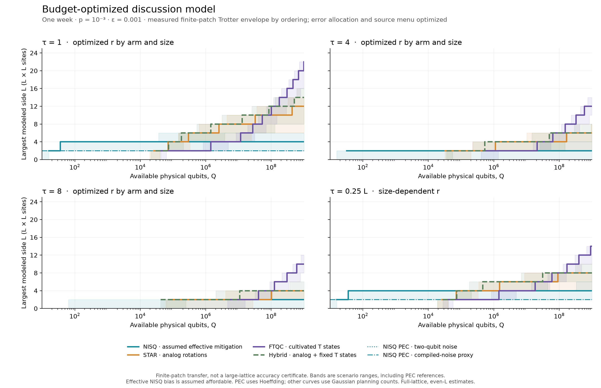

# Hubbard dynamics on a fixed qubit array

For the team discussion, start with the **[back-of-the-envelope+ summary](results/discussion_v3/summary.md)**
and its [assumptions and formulas](docs/DISCUSSION_MODEL.md).



The curves optimize each arm's error allocation, step count, and resource-state
supply. Trotter coefficients are measured through tau = 8 for both termwise
and plaquette orderings; the planning envelope avoids isolated small-patch
cancellations. See the [calibration figure](figures/time_calibration.pdf).
Larger-lattice transfer and effective NISQ residual bias remain assumptions.
The [0.01 absolute-precision sensitivity](figures/discussion_capacity_loose.pdf)
is also available. The fourth panel follows tau = L/4, stopping at L = 32 to
stay within the measured time interval. Run `make discussion` to regenerate
these estimates from saved calibration.

Start with the **[main manuscript](tex/main.pdf)** ([LaTeX](tex/main.tex),
[bibliography](tex/references.bib)). It brings together the analytical resource
laws, CUDA-Q compilation, mitigation, STAR, FTQC and hybrid supply, and the
small-system accuracy checks.

The principal comparison is **maximum modeled lattice size versus available
physical qubits**, subject to a one-week runtime cutoff:

The separate [compiled-reference capacity plot](figures/capacity_vs_qubits.pdf)
retains the more detailed previous implementations.

These are conditional four-step circuit costs. Four steps fail the accuracy
target on the small square patches checked; L ≥ 4 accuracy remains uncalibrated.
The staircases show only tested sizes, and reaching 8 × 8 marks the end of the
current sweep. The [underlying CSV](results/presentation_v1/capacity_thresholds.csv)
retains the original area thresholds.

The NISQ curve is a **sufficient gatewise-PEC sampling budget**, not an
optimized NISQ limit. Its 4 × 4 circuit uses 32 active qubits (36 including
square packing); the strict-precision estimate buys 59,239 replicas to
complete the prescribed shot budget within a week. See the
[experimental comparison and cost breakdown](docs/NISQ_EXPERIMENT_COMPARISON.md)
for why this does not predict the resources used in the Phasecraft experiments.

The [architecture overview](figures/architecture_overview.pdf) and
[patch/supply detail](figures/architecture_detail.pdf) explain resource roles.
The [rotation protocols](figures/rotation_protocols.pdf) show the distinction
in time: STAR injects angle-specific states with retries, while FTQC consumes
high-fidelity T states in a synthesized sequence. Both encoded approaches
share protected Clifford operations; STAR preparation can reuse surgery
ancillas. These drawings are schematic and available as editable SVG,
vector PDF, and PNG in `figures/`.

| Location | Purpose |
|---|---|
| `python/` | Models, compilers, plotting, build and audit scripts |
| `tests/` | Independent mathematical and implementation checks |
| `configs/` | Assumptions, compiler dependency lock, historical filename map |
| `tex/main.tex` | One complete current manuscript |
| `tex/references.bib` | Dedicated bibliography for the main manuscript |
| `tex/archive/` | Earlier complete notes and their original PDFs/bibliographies |
| `figures/` | Current capacity plot and architecture cartoons |
| `results/` | Versioned numerical evidence, compiler artifacts, and manifests |
| `docs/` | Accepted decisions, reproduction guide, older plans and reviews |
| `refs/` | Reference papers |

Use the existing science environment, then:

```bash
conda activate qb_gsee
make test
make paper
make audit
```

`make paper` regenerates the current figures and builds `tex/main.pdf`.
It does not rerun the scientific calculations. To specify an interpreter,
use `make PYTHON=/path/to/python paper`. The build helper uses Tectonic on
PATH or the existing local package cache; `latexmk -pdf main.tex` from `tex/`
also works with a standard TeX installation.

See [REPRODUCING.md](docs/REPRODUCING.md) for scientific reruns, the isolated
CPU CUDA-Q environment, archived-note builds, and compressed MLIR handling.
[WORKING_DECISIONS.md](docs/WORKING_DECISIONS.md) records the accepted conventions.
`PLAN.md` remains at the root because it had an active editor lock during the
reorganization. The latest chronological calculation report is
[REFINEMENT_V3.md](docs/archive/REFINEMENT_V3.md); its source datasets and original
hash manifest remain intact.
