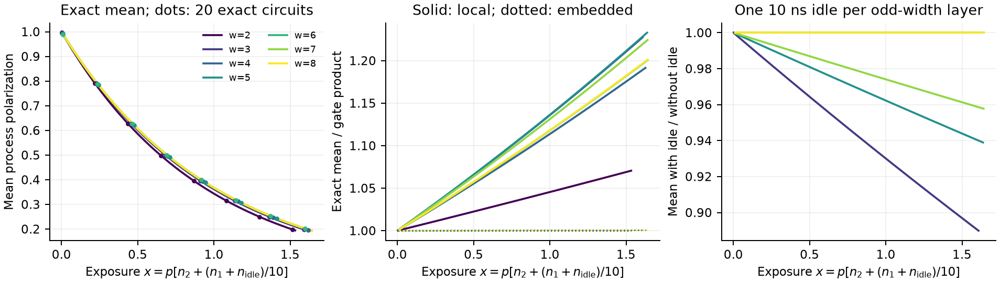

# QUOPS polarization validation — 23 September 2026

**Result.** Near mean polarization 0.2, **exact/local-product = 1.071–1.236**.
Embedding each gate's polarization in the full circuit dimension reduces the
maximum ratio error to **0.215%** across the sweep.

**Coverage.** Exact ensemble means cover widths 2–8, all three requested error
rates, and every integer depth through the first crossing of 0.195 (idle-on
endpoints $D=34$–1277). **Twenty exact individual circuits** cover deep widths
2–6; widths 7–8 have individual checks only at $D=1,2$.
**Deep individual-circuit results at widths 7–8 remain incomplete.**
Their full-depth means use exact analytical averaging over rotations and
matchings. Twenty angle-integrated sampled sequences per width are labeled
separately.

**Model.** Uniform Pauli rotations precede a random oriented CNOT matching;
there is no routing or SPAM. Process infidelities are $p$ per CNOT and $p/10$
per rotation. One unmatched qubit at odd width idles for 10 ns, adding $p/10$.
This follows the brief's time-proportional idle convention, distinct from
PLAN.md C6's default. The [paper](https://arxiv.org/abs/2609.12146v1) reverses
the two sublayers; this study follows the brief.

With $a_w=4^w/(4^w-1)$, the products are

$$
\gamma_{\rm local}=(1-16p/15)^{n_2}(1-4p/30)^{n_1+n_i},\qquad
\gamma_{\rm embedded}=(1-a_wp)^{n_2}(1-a_wp/10)^{n_1+n_i}.
$$

Fit $\gamma=e^{-cx}$, $x=p[n_2+(n_1+n_i)/10]$, on $p=0.001,0.01$ and hold
out $p=0.003$. Shared **$c=1.01331$** gives maximum
$|\gamma/\gamma_{\rm fit}-1|=8.06\%$; width-specific constants give **0.191%**:

| Width | 2 | 3 | 4 | 5 | 6 | 7 | 8 |
|---|---|---|---|---|---|---|---|
| $c_w$ | 1.06936 | 1.01753 | 1.00574 | 1.00249 | 1.00204 | 1.00169 | 1.00186 |

*Held-out $p=0.003$; dots: 20-circuit means with pointwise 95% t intervals.*
Idle lowers polarization by **11.0%, 6.1%, 4.2%** at widths **3, 5, 7** near
the target; even widths have no idle exposure.

**Checks.** PTM and independent Cirq 1.4 Choi calculations agree within
$10^{-15}$; exact quadrature and matching enumeration validate the reduction.
Sample means agree with exact means within 0.0074%. All 140 circuit files
reproduce from seeds; selected replays are bitwise identical.
[Raw data and fits](../results/quops_polarization_v1/),
[derivation and reproduction](../results/quops_polarization_v1/METHOD.md),
and [code](../python/quops_polarization.py) preserve the scope distinction.
