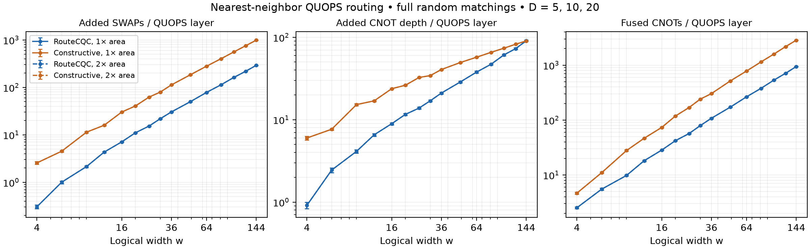

# QUOPS routing on a nearest-neighbor grid

**RouteCQC wins gate count; the constructive network controls depth.** We tested
900 circuits: 15 square/non-square widths from 4 to 144, $D=5,10,20$, 20 seeds
per $(w,D)$, two device sizes and two routers: **3,600 routes**.
Following [the QUOPS paper, II B](https://arxiv.org/abs/2609.12146), each benchmark
layer is a uniform matching of $\lfloor w/2\rfloor$ CNOTs, then independent
$R_P(\theta)$ gates, $P\in\{X,Y,Z\}$, $\theta\sim U[0,2\pi)$.
An odd qubit is omitted uniformly; CNOT orientation is uniform. We use a full
final layer, $\zeta=1$: our $D$ is the paper's $d/2$.

For target area $Aw$, $A=1,2$, the grid has
$C=\lceil\sqrt{Aw}\rceil$, $R=\lceil Aw/C\rceil$.
Both start from the same centered compact snake placement and retain mappings;
the final permutation is tracked, not restored. **RouteCQC:** Cirq 1.4.0,
lookahead 8, spare sites explicitly mapped. **Constructive:** minimum-distance
pair-to-domino assignment, source/destination-row bipartite edge coloring,
then row–column–row odd-even sorting. Transposing if useful bounds
SWAP depth by $B=2\min(R,C)+\max(R,C)$ and SWAP count by
$\lfloor RC/2\rfloor B$ per layer: $O(\sqrt w)$ depth, $O(w^{3/2})$ count.
The larger device may reuse the compact construction; select fewer fused gates,
then shorter depth.

One SWAP costs three CNOTs; $\Delta d_2=(d_2-D)/D$ measures added two-qubit
critical-path depth, excluding single-qubit duration. $G_2$ is the total after
maximal same-edge block fusion, including intervening single-qubit gates:
exact linear synthesis or KAK into full CZs (one CNOT-equivalent each).
Fusion is local, without a global optimality claim.

Fits to width means over **$16\le w\le144$** follow; brackets give 95% bootstrap
intervals for the exponent. Coefficient intervals and separate-$D$ fits are in
[fit.json](../results/quops_routing_v1/fit.json).

| Per benchmark layer | RouteCQC | Constructive |
|---|---|---|
| Added SWAPs $S$ | $0.0710w^{1.678}$ [1.672, 1.684] | $0.354w^{1.599}$ [1.595, 1.603] |
| Added depth $\Delta d_2$ | $0.493w^{1.044}$ [1.034, 1.053] | $4.33w^{0.616}$ [0.612, 0.620] |
| Fused entanglers $G_2$ | $0.354w^{1.588}$ [1.583, 1.593] | $0.865w^{1.634}$ [1.629, 1.640] |

Across $w\ge16$, median matched ratios favor RouteCQC by **3.61× in SWAPs and
2.97× in fused gates**. At $w=144$, fused counts are **941 versus 2,841** per
layer, but fused depths are **91.4 versus 88.1**: the constructive router is
3.6% shallower. Doubling available area changes none of the 900 paired results
for either router under this placement/selection policy; this does not bound
the benefit of other placements or congestion-aware routing.

These finite-range fits have 3–9% maximum mean residuals; including $w=4$ changes
the RouteCQC SWAP exponent to 1.835. Use saved means below $w=16$. Bootstrap
intervals cover sampling, not asymptotic/compiler uncertainty. All 3,600 routing
audits and 16 statevector comparisons passed. Production: 11 minutes on one
48-worker backfill node (PBS 7791427, exit 0).

Reproduce with [python/quops_routing.py](../python/quops_routing.py) `run`
(compute node), then `summarize`; the latter regenerates the figure and fits from
[raw.csv](../results/quops_routing_v1/raw.csv). The saved
[PBS script](../results/quops_routing_v1/run.pbs) uses `ROUTING_MODE=production`.
